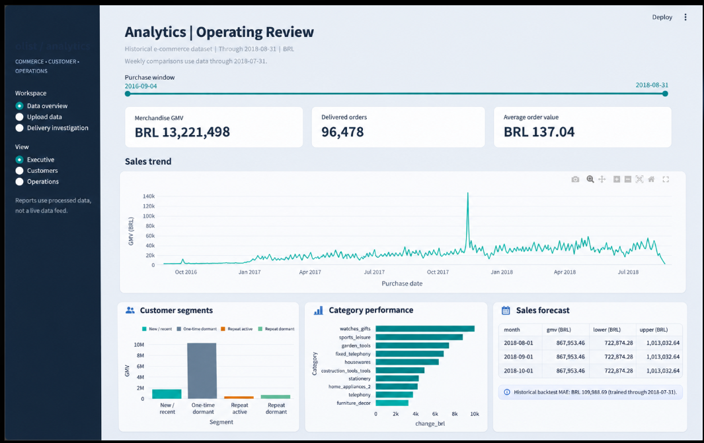
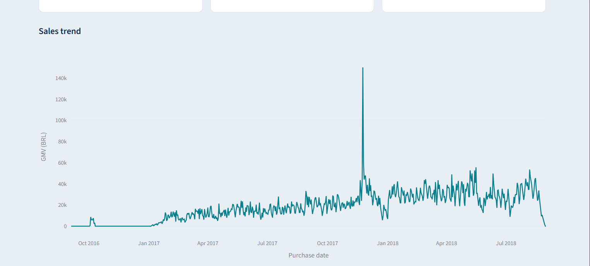
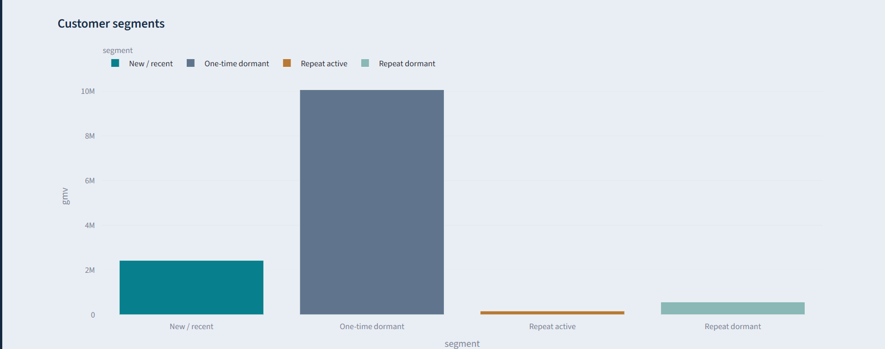
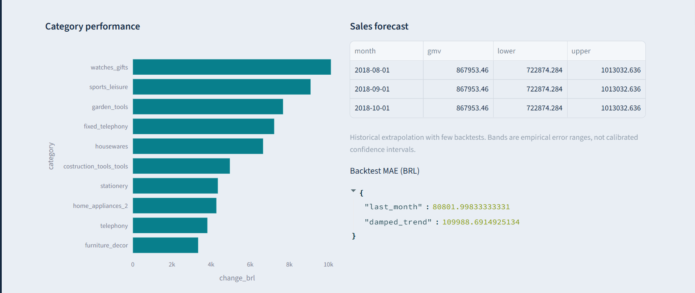
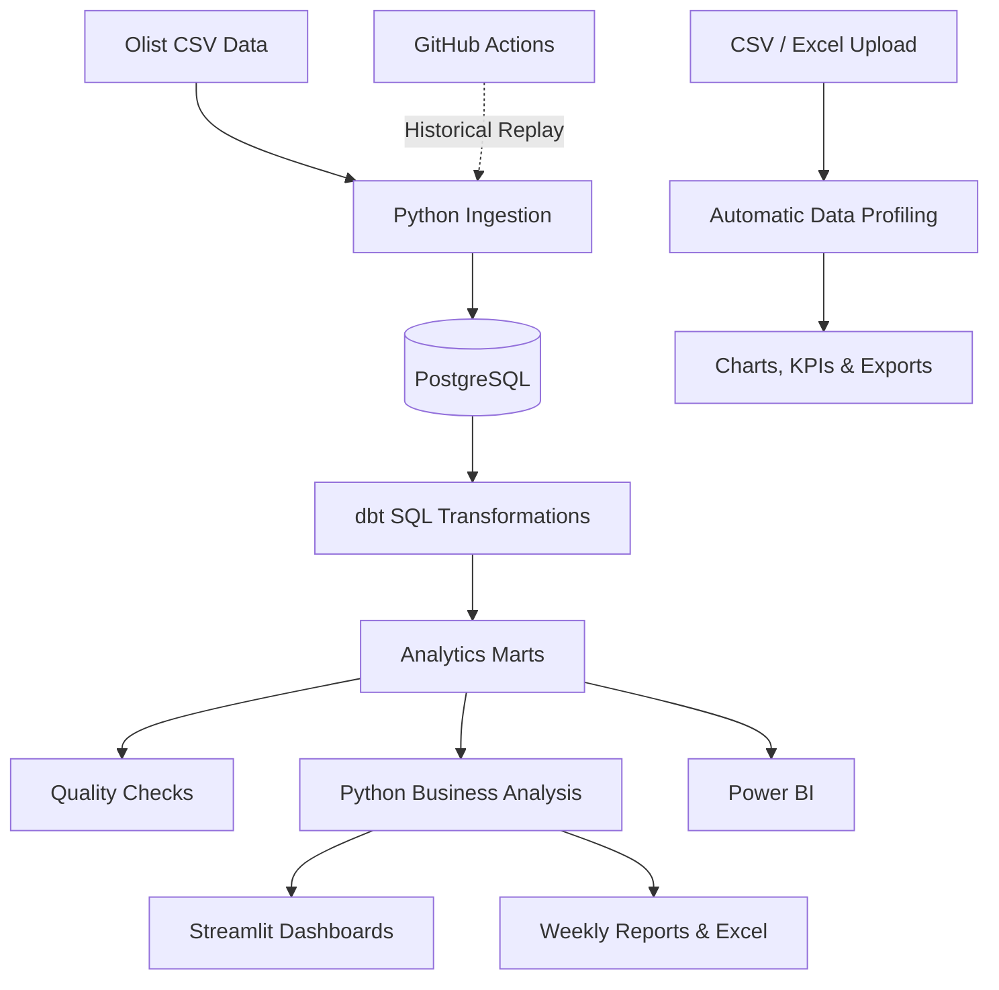

# E-Commerce Analytics Platform
### Business Intelligence, Customer Analytics & Reporting Automation

**Python · SQL · PostgreSQL · dbt · Pandas · Power BI · Streamlit · Excel · Docker · GitHub Actions**

An end-to-end analytics platform built using the Olist Brazilian E-Commerce dataset. The project transforms raw transactional data into business insights, interactive dashboards, and repeatable reporting workflows.

It focuses on sales performance, delivery reliability, customer retention, and operational decision-making.

## Business Problem

E-commerce businesses collect large volumes of information across orders, customers, sellers, products, payments, reviews, and deliveries. The challenge is turning these disconnected datasets into insights that operations and business teams can act on.

I built this project to answer four questions:

- Which factors are associated with delayed deliveries?
- How do delivery delays relate to customer satisfaction and retention?
- Which customers and product categories contribute most to revenue?
- How can recurring business reporting be made more reliable and repeatable?

## Explore the Analytics Workspace

### 1. Executive Dashboard — Platform Overview



*Combined interface illustration showing the main analytical views: executive KPIs, sales performance, customer segmentation, category performance, and forecasting.*

The platform provides a central view of e-commerce performance and helps users move from high-level metrics to specific business questions.

**Key business metrics**

| Metric | Historical result |
|---|---:|
| Merchandise GMV | BRL 13.22M |
| Delivered orders | 96,478 |
| Average order value | BRL 137.04 |
| Late-delivery rate | 6.77% |

### 2. Sales & Revenue Analysis



The sales dashboard tracks daily GMV over the historical purchase period, highlighting revenue movements and periods that deserve investigation.

**Business impact:** Creates visibility into sales trends and supports more informed performance reviews.

### 3. Customer Segmentation



Customers are grouped using Recency, Frequency, and Monetary Value (RFM):

- New / recent customers
- One-time dormant customers
- Repeat-active customers
- Repeat-dormant customers

The displayed analysis shows that one-time dormant customers contribute the largest share of GMV among these segments.

**Business impact:** Identifies customer groups worth investigating for retention and re-engagement opportunities.

### 4. Category Performance & Sales Forecasting



The dashboard compares GMV changes across product categories and provides a three-month historical sales forecast.

Two forecasting methods were evaluated:

| Forecasting method | Backtest MAE |
|---|---:|
| Last-month baseline | BRL 80,802 |
| Damped-trend model | BRL 109,989 |

The last-month baseline achieved lower historical backtest error and produced a forecast of approximately BRL 867,953 per month.

**Business impact:** Provides category-level performance insights and a simple forecasting baseline for planning discussions.

Forecast ranges are empirical historical error bands, not calibrated confidence intervals.

---

## Project Scale

| Metric | Value |
|---|---:|
| Source tables | 9 |
| Source records | 1.55M+ |
| Delivered orders analyzed | 96,478 |
| Historical merchandise GMV | BRL 13.22M |
| Python tests passed | 35 |
| Historical reporting cutoffs configured | 5 |

## Key Business Findings

### Finding 1 — Delivery delays and customer ratings

| Delivery status | Average review |
|---|---:|
| On time | 4.29 / 5 |
| Late | 2.27 / 5 |

Late-delivered orders received an average rating **2.02 points lower** than on-time orders.

**Business implication:** Delivery reliability is an important indicator to examine when investigating customer dissatisfaction.

### Finding 2 — Seller handoff and delivery risk

| Handoff condition | Late-delivery rate |
|---|---:|
| Late seller handoff | 20.96% |
| Timely seller handoff | 5.50% |

Orders with delayed seller handoffs showed **3.81× the observed late-delivery rate**.

**Business implication:** Seller handoff timing can be used to prioritize operational investigations, alongside regional and transportation factors.

### Finding 3 — Delivery experience and retention

| First delivery experience | 90-day repeat-purchase rate |
|---|---:|
| On time | 1.15% |
| Late | 0.77% |

Customers who experienced a late first delivery had an approximately **33% lower observed repeat-purchase rate** relative to the on-time group.

**Business implication:** Delivery experience warrants further investigation as part of customer-retention analysis.

These findings describe historical associations, not proven causal effects or achieved operational improvements.

---

## Data Pipeline & Architecture



### Data Processing

Python ingests the source CSV files into PostgreSQL and records data-quality information.

### SQL Modeling

dbt transforms raw records into reusable analytical models covering orders, customers, sellers, revenue, and delivery reliability.

### Business Analysis

Python and SQL support KPI calculations, statistical comparisons, customer segmentation, cohort analysis, and forecasting.

### Visualization

Streamlit supports interactive analysis and file uploads. Power BI provides stakeholder-oriented business reporting.

---

## Reusable CSV & Excel Analysis

The application also includes an independent upload feature for analyzing new datasets.

Users can upload CSV or Excel files, profile data quality, map transaction columns, generate charts and KPIs, and export results.

### Upload Validation Results

The workflow was tested using a synthetic sales dataset.

| Metric | Result |
|---|---:|
| Orders | 1,000 |
| Customers | 365 |
| Missing values | 0 |
| Duplicate rows | 0 |
| Total sales | BRL 379,202.87 |
| Late-delivery rate | 17.8% |

The exported monthly results reconciled with the reported sales and order totals.

The upload feature operates separately from the historical PostgreSQL warehouse.

## Reporting Automation

The project includes Python workflows for generating:

- Weekly business KPI summaries
- Delivery reliability reports
- Excel reporting workbooks
- Data-quality results
- Operational investigation findings
- Historical execution records

GitHub Actions workflows are configured for quality checks and historical pipeline replay across **five reporting cutoffs**.

A weekly schedule and optional email delivery are configured. Successful unattended GitHub execution and email delivery still require remote verification.

### Local Quality Validation

| Check | Result |
|---|---|
| Pytest | 35 passed, 1 skipped |
| Ruff lint | Passed |
| Ruff formatting | 61 files formatted |
| SQLFluff | Passed |

## Power BI Reporting

The repository includes a Power BI project for business performance and delivery analysis.

**Project:** `dashboards/powerbi/Olist/Olist.pbip`

The Power BI report focuses on stakeholder reporting, while Streamlit supports additional interactive analysis and independent dataset uploads.

Power BI data connections may require configuration on another computer.

## Technology Stack

| Technology | Purpose |
|---|---|
| Python, Pandas, NumPy | Data processing and analysis |
| SQL, PostgreSQL | Data querying and storage |
| dbt | Data transformation and testing |
| Power BI | Business intelligence |
| Streamlit, Plotly | Interactive dashboards |
| SciPy, Statsmodels | Statistical analysis and forecasting |
| Excel | Business reporting |
| Docker | Local infrastructure |
| GitHub Actions | Workflow automation configuration |
| Pytest, Ruff, SQLFluff | Automated quality validation |

## Project Structure

```text
ecommerce-analytics-platform/
├── .github/workflows/
├── dashboards/
│   ├── app.py
│   ├── extras/
│   ├── powerbi/
│   └── *.png
├── data/
├── dbt_project/
├── docs/
├── examples/
├── reports/
├── scripts/
├── sql/
├── src/olist/
├── tests/
├── compose.yaml
├── pyproject.toml
├── requirements.lock
├── requirements-dev.txt
└── README.md
```

## Run Locally

**Requirements:** Python 3.12, Docker Desktop, Git, and optionally Power BI Desktop.

### 1. Install dependencies

```powershell
python -m venv .venv
.\.venv\Scripts\Activate.ps1

python -m pip install -r requirements.lock
python -m pip install -r requirements-dev.txt
python -m pip install --no-deps -e .
```

### 2. Start PostgreSQL

```powershell
docker compose up -d --wait
```

Configure the PostgreSQL connection using the project's environment settings.

### 3. Download and analyze the dataset

```powershell
olist download
olist run --cutoff 2018-08-31 --reporting-end 2018-07-31
```

### 4. Launch Streamlit

```powershell
python -m streamlit run dashboards/app.py
```

Open http://localhost:8501.

### 5. Run tests

```powershell
python -m ruff check .
python -m ruff format --check .
python -m sqlfluff lint sql/showcase
python -m pytest -q
```

## Limitations

- The project analyzes historical rather than live e-commerce data.
- Delivery and retention findings are observational.
- Forecasts provide planning baselines, not guaranteed revenue estimates.
- No realized cost savings or customer-retention improvements are claimed.
- GitHub scheduling and SMTP delivery require remote execution verification.

## Dataset

[Olist Brazilian E-Commerce Public Dataset — Kaggle](https://www.kaggle.com/datasets/olistbr/brazilian-ecommerce)

Built as a portfolio project demonstrating practical SQL, Python, business analysis, data visualization, and reporting automation.
